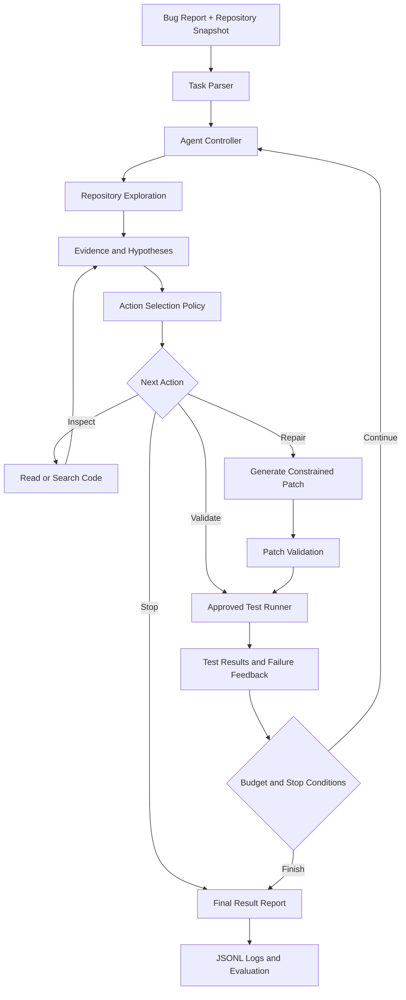

# AutoResolve AI
### A Feedback-Driven Autonomous Agent for Software Debugging and Repair

<p align="center">
  <strong>Investigate → Hypothesize → Patch → Test → Learn → Decide</strong>
</p>

<p align="center">
  
  
  
  
</p>

**AutoResolve AI** explores how autonomous AI agents can diagnose software defects, generate constrained code patches, execute tests, interpret failures, and adapt their next actions using execution feedback.

Instead of treating code generation as the final answer, AutoResolve AI treats every proposed patch as a hypothesis that must be evaluated against executable evidence.

> A generated patch is a hypothesis. An executed test is evidence. A reliable AI engineer must know the difference.

---

## Table of Contents

- [1. Problem Statement](#1-problem-statement)
- [2. Research Question](#2-research-question)
- [3. Proposed Approach](#3-proposed-approach)
- [4. System Architecture](#4-system-architecture)
- [5. Agent Execution Lifecycle](#5-agent-execution-lifecycle)
- [6. Agent Strategies](#6-agent-strategies)
- [7. Experimental Design](#7-experimental-design)
- [8. Evaluation Metrics](#8-evaluation-metrics)
- [9. Technology Stack](#9-technology-stack)
- [10. Repository Structure](#10-repository-structure)
- [11. Getting Started](#11-getting-started)
- [12. Safety and Reliability](#12-safety-and-reliability)
- [13. Development Roadmap](#13-development-roadmap)
- [14. Current Status](#14-current-status)
- [15. Research References](#15-research-references)

---

## 1. Problem Statement

Software debugging is more than identifying a suspicious line of code. A useful repair system must understand the reported behavior, locate relevant code, investigate possible causes, make a minimal change, and verify that the change does not introduce regressions.

A conventional code-generation workflow may stop after producing a plausible solution. An autonomous repair agent must go further.

AutoResolve AI investigates the following problem:

**Given a bug report, a repository snapshot, an approved test configuration, and a limited execution budget, can an AI agent produce a patch that satisfies the required tests while avoiding regressions and reporting uncertainty honestly?**

### Why this matters

- **Reasoning:** The agent must form and revise hypotheses about a defect.
- **Tool use:** It must gather evidence from source files, symbols, and test output.
- **Planning:** It must choose which investigation or repair action to take next.
- **Feedback:** Failed tests should influence subsequent actions.
- **Evaluation:** Its performance must be measured rather than assumed.

The objective is not to replace software engineers or promise perfect repairs. It is to study which agent strategies work, where they fail, and whether additional autonomy is worth its computational cost.

## 2. Research Question

> Can adaptive, feedback-driven investigation improve autonomous software-repair performance compared with simpler repair strategies under the same computational budget?

### Research hypotheses

| Hypothesis | Question to investigate |
|---|---|
| H1 — Feedback | Does retrying with execution feedback improve repair success over a single attempt? |
| H2 — Adaptivity | Does selecting actions based on current evidence outperform a fixed retry policy? |
| H3 — Efficiency | Can adaptive investigation reduce unnecessary tool calls and repeated failed actions? |
| H4 — Reliability | Does final regression testing reduce the number of incorrect repairs reported as successful? |

These are hypotheses to test, not established results.

## 3. Proposed Approach

AutoResolve AI uses a pretrained language model as part of a controlled agent system. The model proposes hypotheses, plans, and patches; deterministic tools inspect files, validate diffs, execute approved tests, and collect evidence.

The research contribution is the **agent workflow, feedback mechanism, action-selection policy, and reproducible evaluation**, rather than training a foundation model from scratch.

Core capabilities planned for the system:

- Structured bug-report interpretation.
- Repository exploration and targeted code retrieval.
- Evidence-based hypothesis generation.
- Explicit action selection and bounded tool use.
- Constrained unified-diff patch generation.
- Test execution and structured failure analysis.
- Retry decisions informed by previous attempts.
- Stop conditions and honest final status reporting.
- Machine-readable experiment logs and comparative metrics.

## 4. System Architecture



### Component responsibilities

| Component | Responsibility |
|---|---|
| Agent controller | Maintains the task state and coordinates each iteration. |
| LLM client | Produces structured reasoning outputs and patch candidates. |
| Planner | Selects an allowed next action based on available evidence. |
| Repository tools | Search symbols, list files, and read relevant source code. |
| Patch validator | Checks diff structure and rejects invalid or disallowed changes. |
| Test runner | Executes trusted, preconfigured tests inside an isolated workspace. |
| Feedback processor | Extracts test failures, exit codes, and relevant error information. |
| Stopping policy | Enforces attempt, time, and tool-call budgets. |
| Evaluation module | Aggregates outcomes and compares agent strategies. |

## 5. Agent Execution Lifecycle

Each repair task follows a controlled feedback loop.

1. **Parse:** Extract expected behavior, observed behavior, and constraints from the issue.
2. **Explore:** Inspect relevant source files, symbols, and tests.
3. **Hypothesize:** Identify likely causes and the evidence needed to distinguish them.
4. **Plan:** Select an approved investigation, patch, validation, or stopping action.
5. **Patch:** Generate a minimal, validated unified diff.
6. **Execute:** Apply the patch in a disposable workspace and run approved tests.
7. **Evaluate:** Inspect actual results, including failures and potential regressions.
8. **Adapt:** Investigate further, revise the patch, or stop when continuation is not justified.
9. **Report:** Record the final status, test outcomes, attempt count, and unresolved issues.

The agent must not equate a syntactically valid patch with a correct repair. A successful test run is evidence for the tested behavior, not proof that the software is universally correct.

## 6. Agent Strategies

The experimental framework will compare three strategies.

### Strategy A — Single-attempt baseline

- Inspect the task and relevant source code.
- Generate one patch.
- Execute the approved tests.
- Report the outcome without a repair retry.

**Purpose:** Establish a baseline for repair performance and cost.

### Strategy B — Feedback-driven retry

- Generate and test a patch.
- Read failure output.
- Revise the patch using that feedback.
- Repeat within a fixed attempt budget.

**Purpose:** Measure the value of execution feedback and retries.

### Strategy C — Adaptive investigation

- Maintain task state, hypotheses, and action history.
- Choose between further inspection, patch revision, validation, and stopping.
- Avoid repeating actions that have already failed without new evidence.
- Stop when the repair succeeds or the available budget is exhausted.

**Purpose:** Measure whether evidence-driven action selection improves the balance between repair quality and resource usage.

All strategies should use comparable task sets, model configurations where possible, and resource budgets.

## 7. Experimental Design

The evaluation will begin with controlled Python repositories containing known defects and reproducible tests. A carefully selected subset of a public software-repair benchmark may be introduced after the core pipeline is reliable.

### Experiment protocol

1. Define and version the task set.
2. Record the expected behavior and trusted tests for each task.
3. Run all strategies against comparable repository snapshots.
4. Enforce the same per-task time and tool-call budgets.
5. Save outcomes in machine-readable JSONL format.
6. Repeat stochastic runs where practical.
7. Compare repair outcomes, costs, and regression behavior.
8. Investigate failures instead of reporting only aggregate scores.

### Example result record

```json
{
  "task_id": "example-001",
  "strategy": "adaptive",
  "model_id": "configured-model",
  "status": "UNRESOLVED",
  "attempts": 2,
  "tool_calls": 7,
  "duration_seconds": 0,
  "tests_passed": 0,
  "tests_failed": 1,
  "patch_applied": false,
  "failure_category": "example_placeholder"
}
```

This is an illustrative schema, not an actual experiment result. Real values must come from the test runner.

### Benchmark direction

- **Initial stage:** Small, self-authored Python debugging tasks with known expected behavior.
- **Evaluation stage:** Held-out tasks to reduce overfitting to development examples.
- **Extension stage:** A selected subset of [SWE-bench](https://github.com/SWE-bench/SWE-bench), subject to benchmark setup, licensing, and compute constraints.

## 8. Evaluation Metrics

The project should evaluate both repair quality and the cost of reaching a result.

| Metric | What it measures |
|---|---|
| Resolution rate | Fraction of eligible tasks satisfying the predefined success criteria. |
| Regression rate | Fraction of attempted repairs that break previously passing tests. |
| Test pass rate | Outcomes of the trusted tests, reported with task-level context. |
| Attempts per task | Number of patch attempts made before stopping. |
| Tool calls per task | Repository and validation operations used. |
| Repair latency | Time from task start to final result. |
| Model usage | Token consumption or estimated API cost, when available. |
| Budget exhaustion rate | Fraction of tasks that stop because limits are reached. |
| Unresolved rate | Fraction of tasks not meeting the repair success criteria. |

### Reporting standards

- Report the denominator for every rate.
- Distinguish test-passing repairs from unresolved attempts.
- Use the same evaluation criteria across strategies.
- Include task-level results and representative failure cases.
- Report repeated-run variability where relevant.
- Do not publish performance claims until experiments have actually run.

## 9. Technology Stack

| Area | Planned tools |
|---|---|
| Core language | Python |
| Model integration | Hugging Face Transformers or a compatible model endpoint |
| Agent orchestration | Custom Python controller and explicit state management |
| Code analysis | Python filesystem, search, and diff utilities |
| Test execution | pytest and an approved test runner |
| Isolation | Restricted disposable containers or equivalent sandboxing |
| Data analysis | Pandas, NumPy |
| Visualizations | Matplotlib |
| Experiment records | JSONL and CSV |
| Version control | Git and GitHub |
| Compute for experiments | Local machine and Google Colab where suitable |

A small code-capable instruction model can be used for early experiments. Model choice should account for context length, code quality, inference speed, hardware limits, and licensing.

A GPU is helpful for local model inference but is not mandatory if a compatible remote model endpoint is available.

## 10. Repository Structure

The following is the **target architecture**; files should be marked as implemented only after they exist and work.

```text
autoresolve-ai/
├── configs/
│   ├── agent.yaml
│   └── experiments.yaml
├── datasets/
│   └── README.md
├── src/
│   └── autoresolve/
│       ├── agent/
│       │   ├── controller.py
│       │   ├── planner.py
│       │   ├── state.py
│       │   └── stopping_policy.py
│       ├── llm/
│       │   ├── client.py
│       │   └── prompts.py
│       ├── tools/
│       │   ├── repository.py
│       │   ├── search.py
│       │   ├── patches.py
│       │   └── testing.py
│       ├── sandbox/
│       │   └── runner.py
│       └── evaluation/
│           ├── metrics.py
│           └── benchmark.py
├── experiments/
│   ├── baseline.py
│   ├── retry_agent.py
│   ├── adaptive_agent.py
│   └── ablation.py
├── tests/
├── results/
│   ├── metrics/
│   └── plots/
├── reports/
│   └── research_report.md
├── scripts/
│   └── run_benchmark.py
├── pyproject.toml
├── requirements.txt
├── README.md
└── LICENSE
```

## 11. Getting Started

### Prerequisites

- Python 3.11 or another version supported by the selected dependencies.
- Git.
- An approved model runtime or compatible model endpoint.
- A safe test-execution environment.

### Clone the repository

```bash
git clone https://github.com/vishwajeethshikari/autoresolve-ai.git
cd autoresolve-ai
```

### Create a virtual environment

Windows PowerShell:

```powershell
py -m venv .venv
.\.venv\Scripts\Activate.ps1
python -m pip install --upgrade pip
```

Linux or macOS:

```bash
python3 -m venv .venv
source .venv/bin/activate
python -m pip install --upgrade pip
```

### Install dependencies

Once `requirements.txt` is available:

```bash
pip install -r requirements.txt
```

### Run tests

Once the project test suite is implemented:

```bash
python -m pytest
```

### Run experiments

The intended entry point is:

```bash
python scripts/run_benchmark.py --config configs/experiments.yaml
```

This command is a planned interface; it will work only after the script and configuration are implemented.

**Note:** This README documents the intended workflow. Follow the actual files and commands present in the repository when the implementation differs.

## 12. Safety and Reliability

Executing model-generated code is a significant security boundary. AutoResolve AI must not run arbitrary generated shell commands directly on a developer's machine.

Safety requirements include:

- Run untrusted code only in a disposable, restricted sandbox.
- Disable unnecessary network access and do not expose credentials or secrets.
- Use trusted, allowlisted test commands and validated arguments.
- Apply resource limits for CPU, memory, execution time, and output size.
- Validate patch paths and reject unexpected file changes.
- Preserve a clean repository snapshot for every task.
- Record tool failures and timeouts as explicit outcomes.
- Require human review before applying changes to real repositories or production systems.

A subprocess timeout alone is not a security sandbox. Isolation must be enforced by the execution environment.

## 13. Development Roadmap

- [ ] **Phase 1 — Evaluation foundation:** Create controlled bug tasks and trusted tests.
- [ ] **Phase 2 — Repository tools:** Implement safe file listing, search, and source inspection.
- [ ] **Phase 3 — Baseline agent:** Generate one constrained patch and run tests.
- [ ] **Phase 4 — Feedback loop:** Interpret test failures and support bounded retries.
- [ ] **Phase 5 — Adaptive controller:** Add action selection, task state, and stopping policies.
- [ ] **Phase 6 — Comparative experiments:** Run controlled strategy comparisons.
- [ ] **Phase 7 — Analysis:** Produce metrics, plots, and failure-category reports.
- [ ] **Phase 8 — Benchmark extension:** Evaluate a suitable subset of SWE-bench.
- [ ] **Phase 9 — Research release:** Document limitations, reproducibility, and verified results.

## 14. Current Status

**Project stage: Research and development planning.**

The architecture, research question, proposed strategies, and evaluation plan define the initial direction. Implementation and experimental results must be documented as they become available.

No repair-success rates, benchmark scores, speed improvements, or claims of production readiness are asserted here.

As development progresses, this section should include:

- Working components and supported environments.
- A reproducible sample run with actual output.
- Automated test results.
- Completed experiments and their methodology.
- Known limitations and unresolved defects.

## 15. Research References

- [SWE-bench — Benchmark for software engineering with real-world issues](https://github.com/SWE-bench/SWE-bench)
- [SWE-agent — Agent-computer interfaces for software engineering](https://github.com/SWE-agent/SWE-agent)
- [SWE-bench project website](https://www.swebench.com/)
- [pytest documentation](https://docs.pytest.org/)
- [Hugging Face Transformers documentation](https://huggingface.co/docs/transformers)

These resources provide background and potential comparison points; their inclusion does not imply that AutoResolve AI reproduces their results.

---

## Project Philosophy

AutoResolve AI is built around one principle:

**Autonomy is not the ability to keep trying. It is the ability to choose useful actions, learn from evidence, respect constraints, and recognize when a problem remains unsolved.**

The goal is to build a reproducible AI engineering system whose capabilities are demonstrated through code, tests, and transparent experiments—not just a compelling demo.
